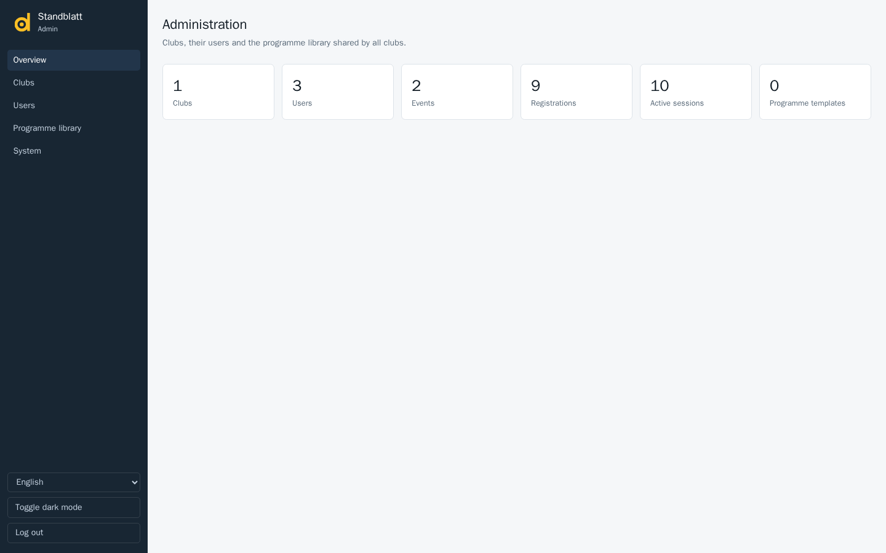
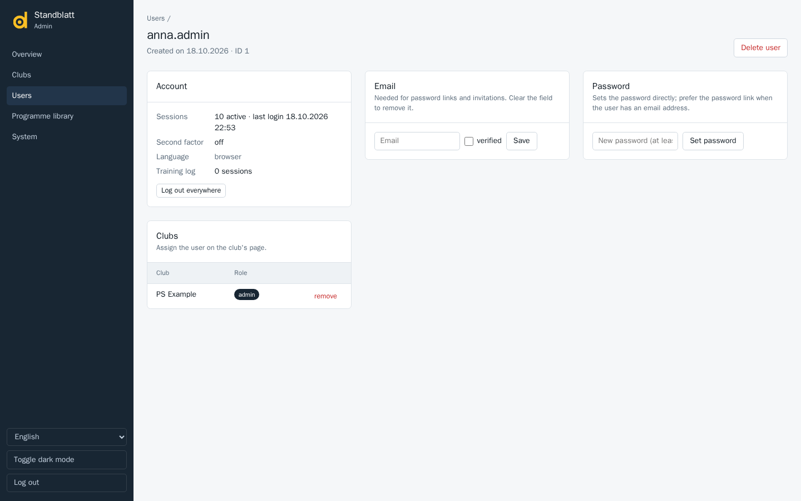

# Admin panel

The admin panel at `/admin` is for the platform operator, not for clubs. It exists only when `STANDBLATT_ADMIN_TOKEN` is set; log in with that token. The login cookie is valid for eight hours on any replica; ten wrong tokens within 15 minutes block further attempts from that address. The panel follows the browser language (English, German, French, Italian); the select at the bottom of the sidebar overrides it.

## Overview

Counts of clubs, users, events, registrations, active sessions and programme templates, the server version and the environment. A maintenance notice with the button to end it appears here when logins are blocked.

## Clubs

The list shows users, events and registrations per club and the creation date. **Create club** creates a tenant and opens its page. On the club page:

- **assign** adds an existing user by user name or email address with one of the default roles *admin*, *board*, *staff* (the app calls it *Helper*) or *member*; **remove** takes the access away. The club sets up its own roles in the app. Club admins can also [invite people by email](../../web/src/help/en/user-guide/users.md) themselves.
- The events of the club, newest first, with their status (open or archived).
- **Delete club** removes the club with all its data (ranges, events, registrations, shooters). It asks for confirmation and cannot be undone.

## Users

Search by a part of the name or email. The list shows the email with its status (confirmed or not), the clubs, whether the second factor is on, active sessions and the last login. **Create user** takes a user name, an optional email and a password; without a password the user gets a mail with a link to set one (an email is required then). On the user page:

- **Account**: sessions and last login, second factor, language, number of training sessions; **Log out everywhere** ends all sessions, **Reset second factor** removes the authenticator of a user who lost the phone.
- **Email**: set, change or clear the address and tick *verified* when you know it is right. **Send password link** mails a link valid for seven days to set a new password; prefer it over setting a password by hand.
- **Password**: **Set password** sets it directly (at least 10 characters).
- **Clubs**: the memberships with **remove**; assign on the club page.
- **Delete user** removes the account with its personal training log.

## Programme library

Programme templates that every club can add to its events. **Upload template** takes a [programme file](../../web/src/help/en/reference/programme-file.md) exported from an event; a template with the same name and variant is replaced. **download** and **delete** per template.

## System

- **Maintenance mode** blocks new logins; users already logged in keep working. **Allow logins again** ends it. The sidebar shows a notice on every page while it is on.
- **Revoke all sessions** logs out every user on every replica.
- **Instance**: version, environment, whether self sign-up and the second factor are enabled.

**Toggle dark mode** in the sidebar follows the same setting as the app.
