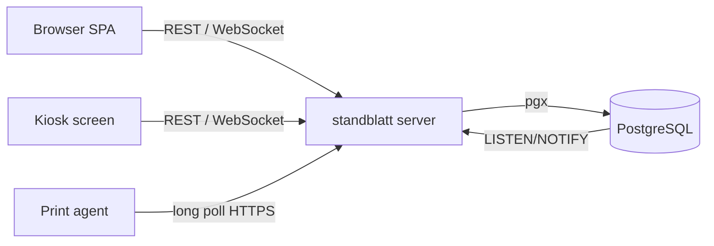

# Architecture

Standblatt is one Go server with the SvelteKit app embedded, backed by PostgreSQL, built to run as stateless replicas on Kubernetes.

## Repository layout

| Path | Content |
|---|---|
| `cmd/standblatt` | server entry point and janitors; `standblatt openapi` prints the API spec |
| `cmd/print-agent`, `internal/agent` | the print agent |
| `internal/domain` | rules without storage or HTTP: age categories, programme definitions, registration rules, results and awards, ranking, club competition, special prizes, lane syntax, amount in words |
| `internal/store` | handwritten pgx store; `migrations/*.sql` embedded and applied at startup |
| `internal/web` | HTTP: health checks, huma API under `/api`, admin panel, SPA fallback |
| `internal/docs` | PDF rendering with go-pdf/fpdf |
| `internal/i18n` | gettext catalogs for documents and exports |
| `internal/realtime` | WebSocket hub fed by PostgreSQL `NOTIFY` |
| `web/` | SvelteKit 2 SPA (Svelte 5, Tailwind, TanStack Query, shadcn-svelte); the help pages in `web/src/help/` |
| `e2e/` | Playwright specs |
| `helm/` | Helm chart (values per environment live in the cluster's GitOps repo) |
| `docs/` | operations and development documentation (this folder) |

## Tenancy

A tenant is a club. Every tenant-scoped store method takes the tenant ID and every query filters on it; there is no row-level security. API paths are `/api/tenants/{tenantId}/…` and every handler first calls `s.access(ctx, tenantID, adminOnly)`, which answers 404 to non-members. Join tables carry `tenant_id` with composite foreign keys. `internal/store/tenants_test.go` checks the isolation and must grow with every new table.

## Authentication

Global users with bcrypt passwords; sessions in PostgreSQL keyed by the SHA-256 of the cookie token (`standblatt_session`, sliding 7 days, at most 30). Kiosk links and print agents use their own hashed tokens and never create a session. The admin panel uses a stateless HMAC-signed cookie scoped to `/admin`.

## Realtime

Handlers call `s.notify(ctx, tenant, event, topics…)` after a change, which runs `pg_notify`. Every replica holds one `LISTEN` connection and forwards the topics to the WebSocket clients of that tenant and event. The frontend (`web/src/lib/live.svelte.ts`) invalidates TanStack queries by topic; all event-scoped query keys start with `['tenants', t, 'events', e]`, so a reconnect simply invalidates that prefix.

## Documents

`internal/docs` renders PDFs with fpdf's core Helvetica (cp1252), QR codes and Interleaved 2 of 5 barcodes. Reports are generic tables (`docs.Report`) rendered as PDF or CSV; a new report is a new case in `eventData.report` in `internal/web/reports.go`.

## Printing

`print_jobs` is a queue in PostgreSQL. Agents long-poll `GET /api/agent/jobs/next`, which claims a job with `FOR UPDATE SKIP LOCKED`, and confirm it with `POST /api/agent/jobs/{id}`.
